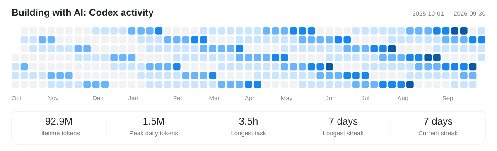

# Codex Activity Banner

A clean, full-width Codex activity banner for your GitHub profile. One rolling year of activity, with a compact row of five usage statistics.

[简体中文](README.zh-CN.md) · [Local scheduling](docs/scheduling.md) · [Privacy](SECURITY.md)



**The preview above uses entirely synthetic data.** It does not show a real account.

## What you get

- A light, blue heatmap covering the last complete rolling year: 365 or 366 days.
- Lifetime tokens, peak daily tokens, longest task, longest streak and current streak.
- A 1200 × 366 SVG that scales to the full width of a GitHub README.
- A configurable heading and display timezone.
- Local collection through your signed-in Codex CLI. No hosted service or cloud account credentials to set up.

This is an independent adaptation of [Codex Usage Profile](https://github.com/postmelee/codex-usage-profile), focused on a wide SVG layout and local updates. The calendar placement and heat-level algorithm derive from that project; see [Credits](#credits-and-license).

## Try the demo

You need **Node.js 20 or later** and Git. The demo needs no Codex login.

```sh
git clone https://github.com/carrey325/codex-profile-automation.git codex-activity-banner
cd codex-activity-banner
npm ci --ignore-scripts --no-audit --no-fund
npm run demo
```

Open `docs/preview.svg` to see the result. This command always generates the same synthetic example.

## Generate your own banner

Install a recent [Codex CLI](https://learn.chatgpt.com/docs/cli) and sign in with your ChatGPT account using `codex login`. The CLI must be on your PATH and support `account/usage/read`; this project was developed with Codex CLI **0.149.1** and pins `codex-usage-analyzer` to **0.4.1**. API-key-only authentication does not provide these ChatGPT account usage statistics.

```sh
npm run update
```

Your SVG is written to `output/codex-activity.svg`. The `output` directory is ignored by Git so your real usage is not accidentally committed to this tool repository.

Choose a timezone or write directly into a **local clone** of your profile repository:

```sh
npm run update -- --timezone "America/New_York" --output "../YOUR_USERNAME/assets/codex-activity.svg"
```

Replace `../YOUR_USERNAME` with the path to your own `YOUR_USERNAME/YOUR_USERNAME` profile repository. Paths with spaces should be quoted. The script generates the file; **it does not commit or push anything**.

## Add it to your GitHub profile

In your profile repository's README, add:

```html

```

Commit and push the SVG and README from that profile repository. GitHub may take a short time to refresh its image cache.

```sh
git add README.md assets/codex-activity.svg
git commit -m "Add Codex activity banner"
git push
```

For later refreshes, generate the SVG again and commit only the image. You can also let a [local Codex scheduled task](docs/scheduling.md) perform those steps each week.

## Options

```sh
npm run update -- --help
npm run update -- --title "Building with AI: Codex activity" --timezone "Asia/Shanghai"
npm run update -- --input "/path/to/aggregate-usage.json" --output "output/banner.svg"
```

| Option | Default | Purpose |
| --- | --- | --- |
| `--output` | `output/codex-activity.svg` | Destination SVG; parent directories are created |
| `--timezone` | `UTC` | Timezone used to determine the displayed end date |
| `--title` | `Building with AI: Codex activity` | Heading, up to 40 characters |
| `--demo` | Off | Render synthetic data without contacting Codex |
| `--input` | None | Render an aggregate JSON document instead of contacting Codex |

For the JSON shape, see [`demoUsage()`](src/demo.mjs). Input accepts the analyzer's `capturedAt`, `summary` and `dailyUsageBuckets` fields. A null metric displays as `—`; null daily buckets display as unavailable. Invalid input leaves an existing output file untouched.

The calendar covers one year, but **the summary metrics retain their account-level scope**. Lifetime tokens are not a sum of only the visible year. Daily bucket dates remain the dates returned by Codex; selecting a timezone does not rebucket the underlying activity. This tool cannot reconstruct history that the upstream service does not provide.

## Local updates and privacy

The collector delegates authentication to your local Codex CLI. It does not copy your login into GitHub Secrets and does not scan local conversation transcripts. Only aggregate statistics and daily token totals enter the SVG. Publishing it makes that activity visible to everyone who can view the image.

This repository's GitHub Actions workflow runs **tests and the synthetic demo only**. It neither collects live usage nor publishes a user's profile. Real updates run on your computer; a scheduled local update needs that computer and Codex to be available. The scheduling example explicitly skips missed runs.

Never commit `auth.json`, access tokens, refresh tokens or credential files. See [SECURITY.md](SECURITY.md) for the data boundary.

## Development

```sh
npm test
npm run demo
```

Tests cover rolling-year boundaries, leap days, unavailable metrics, timezone selection, XML escaping, input validation and preserving a previous banner after failure. CI runs on Windows and Linux without account credentials.

## Credits and license

- The calendar placement and heat-level algorithm are adapted from [`src/profile-card/heatmap.js`](https://github.com/postmelee/codex-usage-profile/blob/6d3e600d2d33bb7a50147075d013ddd9b945d0b1/src/profile-card/heatmap.js) in **postmelee/codex-usage-profile**, at commit `6d3e600d2d33bb7a50147075d013ddd9b945d0b1`.
- The wide layout, metric bar, configurable local renderer, synthetic preview and reusable setup are developed in this repository.
- Usage collection uses [`codex-usage-analyzer`](https://www.npmjs.com/package/codex-usage-analyzer).

Released under [MIT](LICENSE). The upstream copyright notice and MIT license are retained in [LICENSE.upstream](LICENSE.upstream). This is a community project, not an official OpenAI product.
